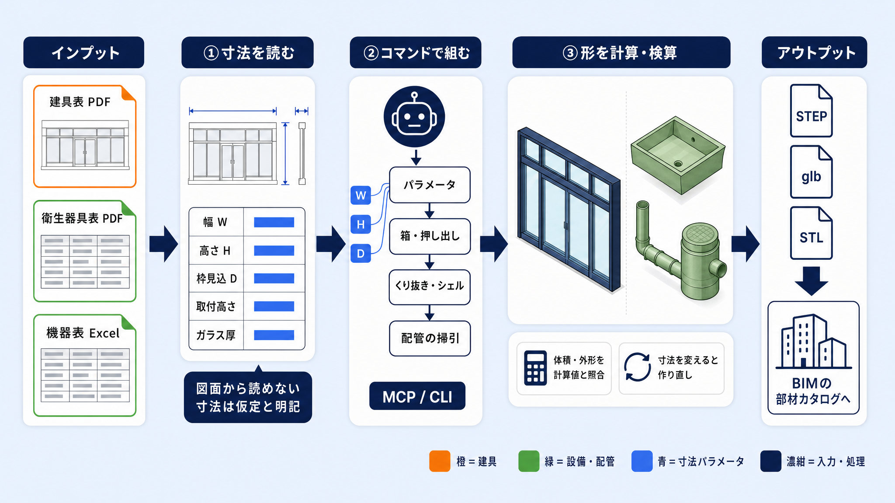
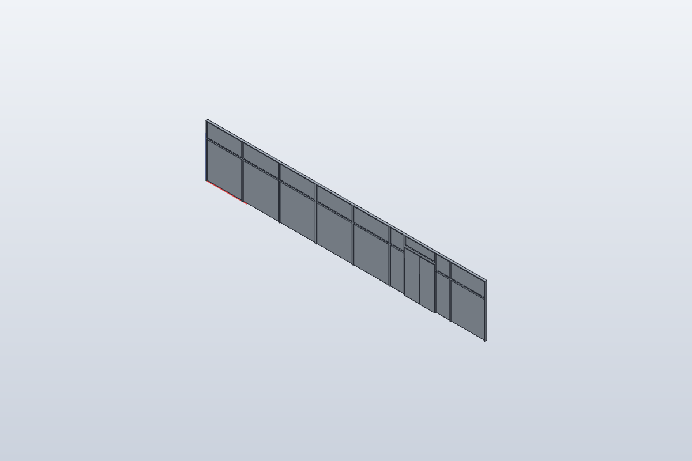
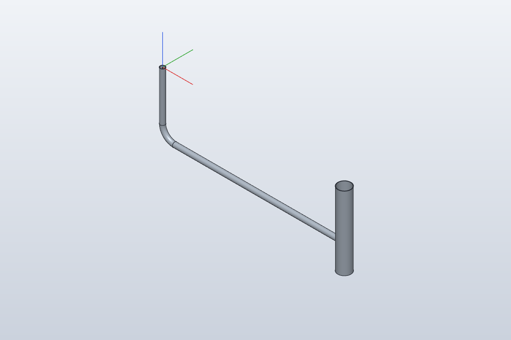
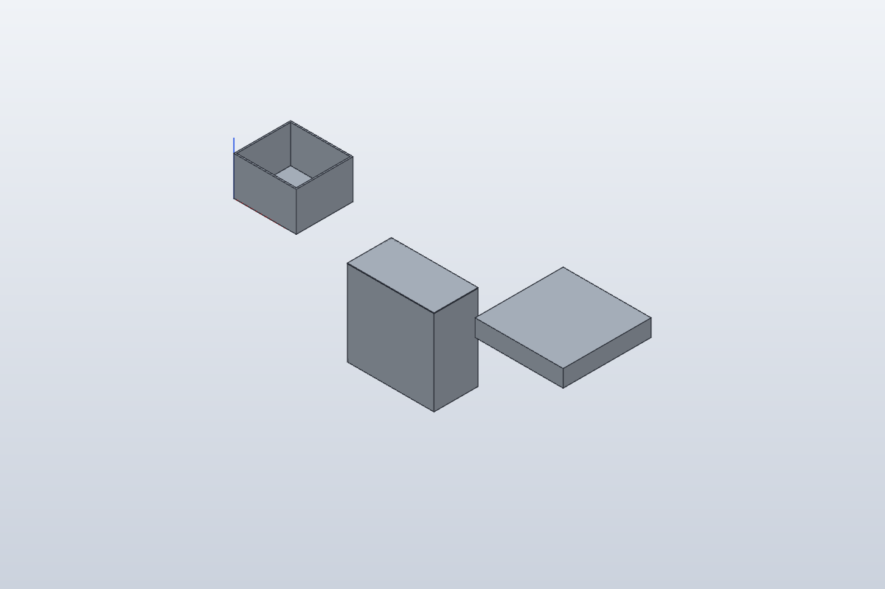

# KKG Object Modeler の仕組みと試行結果

KKG Object Modeler は、オープンソースのパラメトリック 3D CAD「SolidCraft」をフォークしたものです。建具表・器具表・機器表の寸法から、建具・設備機器・配管の 3D 部品を作り、BIM に渡すことを目指しています。

このページには、仕組み、動かし方、実際の建具表・衛生器具表を使って試した結果をまとめます。

> SolidCraft 本体のドキュメントは英語で書く決まりです（`AGENTS.md`）。KKG 向けのまとめは、本体と混ざらないよう `docs/kkg/` に日本語で置いています。

## 仕組み



入力から出力までの各段階を、誰が担うかと合わせて示します。

| 段階 | 担い手 | 中身 |
|---|---|---|
| ① 寸法を読む | AI エージェント（Claude・Codex など） | 建具表・器具表から幅・高さ・枠見込・取付高さ・ガラス厚などを読む。図面に無い寸法は「仮定」と明記する。SolidCraft 自身は図面を読まない |
| ② コマンドで組む | エージェント → SolidCraft のエンジン | 寸法をパラメータとして登録し、「箱」「押し出し」「くり抜き」「シェル」「配管の掃引」などのコマンドを順に送る。入口は MCP（22 ツール）と CLI の JSON スクリプトの2つで、どちらも同じコマンドを動かす |
| ③ 形を計算・検算 | SolidCraft のカーネル | コマンドは「履歴（タイムライン）」として残る。B-rep カーネル（同梱の solidcore）が厳密な形状を計算する。パラメータを変えると、変わった所から作り直す。`measure` で体積・外形・重心を返すので、エージェントは自分で計算した値と照合できる |
| 出力 | SolidCraft の入出力 | STEP（CAD 向け）、glb（Web 表示・KKG ONE の部材カタログ向け）、STL・3MF・OBJ（メッシュ）、`.sc`（履歴ごと保存し、後から寸法を変えられる） |

内部はクレートを層に分けた構成です。各層の役割は [architecture.md](../architecture.md) と [layers.md](../layers.md) にあります。部品づくりに関わるのは次の4つです。

- **`engine`（L4）**: 全操作が「コマンド」。画面・スクリプト・MCP が同じコマンド一覧を使うので、人が画面でできることはエージェントもできる
- **`doc`（L2）**: パラメータ・式・履歴を持ち、変わった所から作り直す
- **`kernel` / `solidcore`（L1）**: 形状計算。図形の判定には近似のメッシュを使わず、厳密な形状を使う
- **`io`（L3）**: STEP・glb などの読み書き

## 動かし方

```sh
# 初回のみ。rust-toolchain.toml の版（1.99.1）が自動で入る。Windows では Visual Studio Build Tools が要る
cargo build --release -p solidcraft-cli        # 初回の全体ビルドは約40分（16コア）

# スクリプトから部品を作り、STEP と glb を書き出す
target/release/solidcraft-cli run examples/kkg-trial/window_smoke_exhaust.json --out window.step --out window.glb

# 体積・外形を JSON で受け取る
target/release/solidcraft-cli eval examples/kkg-trial/window_smoke_exhaust.json --json-out measure.json

# 画像にする
target/release/solidcraft-cli snapshot examples/kkg-trial/window_smoke_exhaust.json --out window.png --view iso

# エージェントから使う（Claude Code の場合）
claude mcp add solidcraft -- target/release/solidcraft-cli mcp
```

試行用のスクリプトは `examples/kkg-trial/` にあります。

- **`generate.py`**: 図面の寸法からスクリプト（`*.json`）を作り、同じ寸法から体積・外形の期待値（`expected.json`）を計算する。期待値は SolidCraft の出力を見ずに出す
- **`check.py`**: 全スクリプトをビルドし、`out/` に STEP・glb・画像・`report.json` を書き出して、期待値と比べる

## 試行結果

実案件の建具表と衛生器具表（A3、ベクター PDF）から寸法を読み、4種類の部品を作りました。寸法は人が図面から読み取り、`generate.py` に書いています。今回はエージェントに読ませていないので、①の読み取りの精度はこの試行では測れていません。

| 部品 | 図面から読んだ寸法 | 仮定した寸法（図面に記載なし） | 体数 | 体積の差 | 作成時間 |
|---|---|---|---|---|---|
| 排煙窓（半外付・内倒し） | W1100・H800・枠見込70・取付高さ FL+1500・有効開口1012×587・ガラス17.8 | 無し | 2 | 0.0000% | 0.25秒 |
| 店舗正面サッシ＋引分け自動ドア | 全幅14145.5・H2630・枠見込100・7区画の幅・方立60・無目 FL+1820・ドア 777.5×2・DH2097・ガラス26/22/5 | 外周の枠30、扉の框（ガラス5mmだけで表現） | 20 | 0.0000% | 2.85秒 |
| 洗濯流し・グリーストラップ・流し台座 | 440×400×275、610×310×600、620×620×120 | 槽の肉厚10・5 | 4 | 0.0000% | 0.21秒 |
| 排水管＋小口径桝 | 桝150φ | 管径（VP50、外径60・肉厚4.1）、経路（立下り600・曲げR150・横引き2000） | 2 | 0.0001% | 0.39秒 |

- **体積の差**: SolidCraft が計算した体積と、同じ寸法から手計算した体積との差。全部品の外形（bbox）も期待値と一致した
- **寸法の変更**: 排煙窓を作った後に W・H を 1400×900 に変えると、枠もガラスも新しい寸法で作り直された（体積・外形とも期待値と一致）
- **作成時間**: スクリプトの読み込みから形状計算までの時間（Windows、16コア）







### 分かったこと

**できること**

- **寸法の正確さ**: 表に書かれた寸法どおりの形が、計算値と一致する精度で作れる。寸法を変えれば作り直されるので、同じ型の建具を寸法違いで量産できる
- **組み立ての速さ**: 20体のサッシで3秒弱。エージェントが試行錯誤しても待ち時間は問題にならない
- **エージェントからの操作**: MCP のツール（`batch`・`measure`・`set_parameter`・`screenshot`・`export` など22個）がそろっている。「組む → 測る → 期待値と照合」をエージェントが自分で回せる

**まだできないこと・別に要るもの**

- **機器の外形寸法**: 今回の空調機器表には型番・能力・電気容量だけがあり、外形寸法が無かった。設備機器を作るには、メーカーのカタログや BIM データから寸法を取る仕組みが別に要る
- **配管の経路**: 器具表・凡例・桝リストには経路・管径が無い。経路は平面図・系統図から読む必要がある。今回は経路と管径を仮定した
- **建具の細部**: 枠・框の断面形状、金物、扉の厚みは建具表に無い。今回は箱で表した。断面図や標準詳細を入力に加えれば、押し出しや掃引で表せる
- **IFC 出力**: SolidCraft は IFC を書き出さない。KKG ONE に渡すには、glb を部材カタログに入れるか、STEP・glb から IfcDoor・IfcFlowTerminal などの形状に変換する処理が要る
- **配管の接続**: 今回のスクリプトは管と桝を別の物体として置いただけで、桝に穴を開けていない。接続部の形はスクリプト側で作る必要がある

## ライセンス上の注意

- **使ってよい部分**: 形状計算・コマンド・CLI・MCP などのコードは MIT OR Apache-2.0。社内製品として改変・配布してよい。著作権表示（`LICENSE-MIT`・`LICENSE-APACHE`・`NOTICE`）は残す
- **許可が要る部分**: 画面部品（`crates/ui-kit`）、見た目（`crates/look`）、テーマ（`crates/theme`）、SolidCraft の名前・ロゴ・アイコンは `LICENSE-BRAND` の対象。SolidCraft 以外の製品で使うには、先方の書面での許可が要る
- **当面の使い方**: CLI・MCP 経由で画面を使わずに動かすなら、ブランドの対象には触れない
